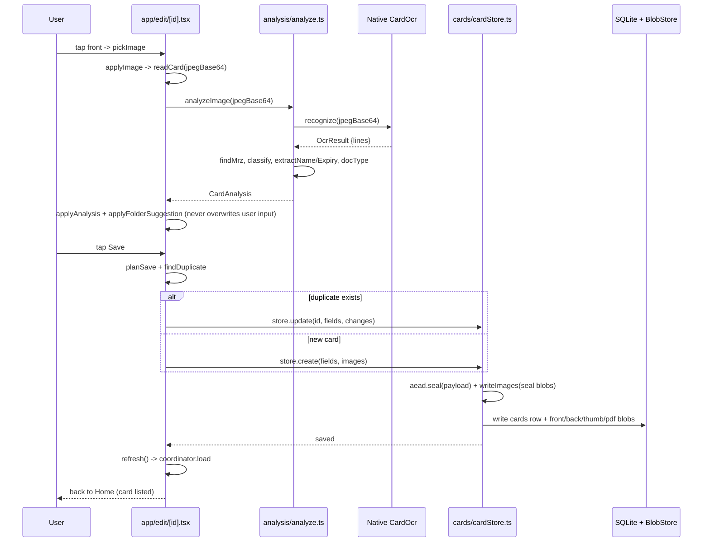

# CardHolder — Application Flow

```mermaid
flowchart TD
    Start([App launch]) --> Layout[RootLayout _layout.tsx]
    Layout --> Fonts[Bundle fonts, lock portrait, setup notifications]
    Fonts --> Provider[AppProvider]
    Provider --> Boot{boot.ts}
    Boot --> Migrate[migrate DB + create settings]
    Migrate --> Keyring[openKeyring / secureVault]
    Keyring --> Orphan{orphaned?}
    Orphan -->|yes| OrphanedScreen[Orphaned state]
    Orphan -->|no| Store[createCardStore(db, blobs, aead)]
    Store --> Ready{phase === ready?}
    Ready -->|no| BootScreen[BootScreen]
    Ready -->|yes| LockedApp[AppLockGate]

    LockedApp --> Home[Home index.tsx]
    Home --> View{gallery or stack?}
    View -->|stack| CardStack[CardStack swipe]
    View -->|gallery| CardGrid[CardGrid]
    Home --> Filter[search / tag / folder filter]
    Home --> Pinned[PinnedStrip]

    Home -- FAB / add --> Price{canAddCard?}
    Price -->|no| Paywall[/paywall/]
    Price -->|yes| Edit[/edit/new/]

    Home card tap --> CardDetail[/card/[id]/ detail/]
    Home batch sel -->|pin,tag,recreate,share,delete| Store

    Edit -- front photo picked --> OCR[analyzeImage -> recognizer.ts]
    Edit -- back photo picked --> OCR
    Edit -- pdf attached --> PdfRender[m modules/card-pdf render cover/back]
    OCR --> Native[requireOptional Native 'CardOcr']
    Native --> iOS[iOS Vision]
    Native --> Android[Android ML Kit / PaddleOCR]
    Native -- OCR lines --> Analyze[analyze.ts]
    Analyze --> MRZ[findMrz]
    Analyze --> Class[classifyCard]
    Analyze --> Fields[extractName / extractExpiry]
    Analyze --> DocType[detectDocumentType + suggestedTag]
    Analyze -- suggestions --> Edit[pre-fill name/tags/expiry/folder]

    Edit -- Save --> Plan[planSave: valid / invalid / limit]
    Plan --> Dup{findDuplicate?}
    Dup -->|yes| AskReplace[askReplace: keep or replace?]
    AskReplace -->|replace| Update[store.update on existing id]
    AskReplace -->|cancel| Edit
    Dup -->|no| Create[store.create]
    Create --> Seal[aead.seal payload]
    Update --> Seal
    Seal --> SQL[(sqliteDb cards/folders)]
    Seal --> Blob[(encrypted BlobStore images/pdf)]

    Create/Update --> Refresh[coordinator.load -> readSnapshot]
    Refresh --> Home[re-render home]
    Refresh --> Widget[syncWidget home-widget]
    Refresh --> Reminders[syncReminders -> shortcuts + scheduler]

    Home -- settings --> Settings[/settings/]
    Home -- folders --> Folders[/folders/]
    Home -- tags --> Tags[/tags/]
    Home -- export --> Export[/export/]
    Home -- import --> Import[/import/]

    subgraph Storage[Storage Layer]
      SQL
      Blob
      Settings[(settings.ts)]
    end
```

## Data flow — adding one card



## Key modules

| Area | Location | Role |
|------|----------|------|
| Routing / screens | `app/*.tsx` | Expo Router stack (home, edit, card, settings, folders, tags, import, export) |
| App state & boot | `src/app/*` | `AppProvider`, `boot.ts`, `refreshCoordinator.ts` (single load-wins coordinator) |
| Card store | `src/cards/cardStore.ts` | CRUD, encryption seal, blobs, folders, `insertMany` import |
| OCR pipeline | `src/analysis/*` | `analyze.ts` -> classify, MRZ, fields, docType; `recognizer.ts` -> native |
| Native OCR | `modules/card-ocr` | Vision (iOS), ML Kit / PaddleOCR (Android) |
| PDF | `modules/card-pdf`, `src/images/pdf.ts` | render cover/back pages |
| Crypto | `src/crypto/*` | `keyring.ts`, `secureVault.ts`, `aead.ts`, `engine.ts` |
| Storage | `src/storage/*` | `sqlDb.ts`, `blobStore.ts` / `fileBlobStore.ts`, `settings.ts` |
| Background | `src/reminders`, `src/widget`, `src/shortcuts` | expiry reminders, home widget, quick actions |
